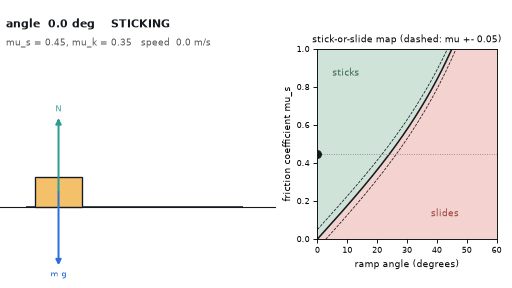
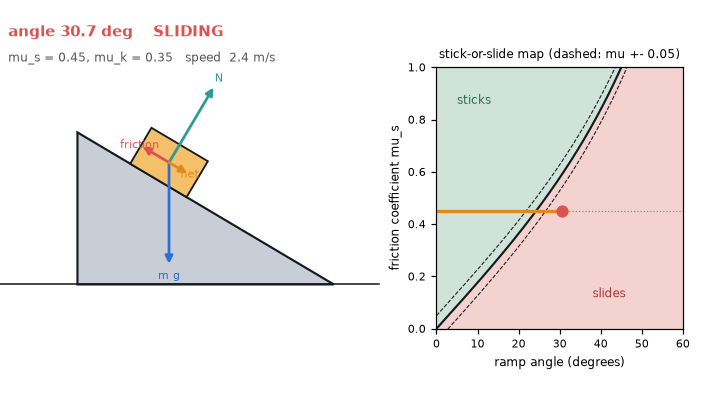
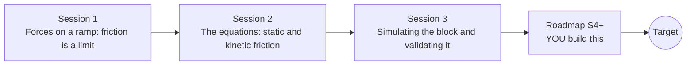

# openincline

[](https://github.com/KrunalPanchal1995/openincline/actions/workflows/ci.yml)   [](https://colab.research.google.com/github/KrunalPanchal1995/openincline/blob/main/sessions/session-01/lesson.ipynb) [](https://krunalpanchal1995.github.io/openincline/)

**Find the angle where a block starts to slide, in three sessions.**

openincline teaches forces on a ramp, from the free-body diagram to a validated friction simulation, using only Python and a browser.

- **Start from zero.** Session 1 needs only school trigonometry and the idea of a force.
- **See it move.** Every session ships a slider app with a free-body diagram and labelled graphs.
- **Know you got it right.** Each session ends with a checkpoint that prints PASS or FAIL against hand calculations.
- **Build the missing half.** The repo stops at Session 3 on purpose; the roadmap shows the path to the Target.

[Target](#the-target) · [Who is this for](#who-is-this-for) · [Quick start](#quick-start) · [Sessions](#sessions) · [Roadmap](#roadmap) · [Contribute](#contribute) · [Explainer PDF](docs/explainer.pdf)

> **This repo is incomplete on purpose.** Sessions 1 to 3 are here and fully working. The finished Target below is a preview of what the community can build next. We show you the path, not the code. Sessions 4 and up are yours.

## The Target

A ramp tilts slowly while a block sits on it, with arrows for weight, normal force, friction and net force. On the right, a map of friction coefficient against angle shows the stick region and the slide region, and the block's moving point crosses the boundary at exactly the moment the block lets go. Dashed lines show how an uncertain friction coefficient blurs that boundary. Your goal over the coming sessions: build this animated ramp and its stick-or-slide map yourself.



*Target: a tilting ramp with force vectors and the stick-or-slide map*



*Target still: the block at the moment it lets go*

Try it live:

- [Math Visual Studio: free-body diagrams (Atlas S37)](https://krunalpanchal1995.github.io/studio/#atlas?ch=S37&ex=1)
- [Math Visual Studio: friction (Atlas S42)](https://krunalpanchal1995.github.io/studio/#atlas?ch=S42&ex=1)

How the Target was made is shown only as a path in [promo/roadmap.md](promo/roadmap.md).

## Who is this for
**secondary school to diploma / undergraduate (levels 3-5).** Topic area: Physics and the Science of Motion.

Prerequisites:

- Sine, cosine and tangent of an angle (school trigonometry).
- What a force is, and that forces are measured in newtons.
- Python 3.10 or newer; if `python --version` works, you are ready. PRIMER.md explains the rest.
- No prior GitHub, calculus or physics-lab experience is needed.

New to Python? Read [PRIMER.md](PRIMER.md) first (10 minutes).

## Quick start

No installation knowledge needed. You need [Git](https://git-scm.com/downloads) and [Python 3.10+](https://www.python.org/downloads/) (Windows: tick "Add Python to PATH"). On Mac and Linux type `python3` wherever this page says `python`.

```bash
git clone https://github.com/KrunalPanchal1995/openincline.git
cd openincline
python start.py 1
```

`start.py` creates a private environment, installs what is needed and runs Session 1 with its checkpoint. Next: `python start.py 2`, `python start.py 3`, or `python start.py test` to check everything. Only a checkpoint: `python start.py check 1`.

Four lines turn the idea of Session 1 into a result (they work as they are): Save it as `try.py` and run it with `python start.py run try.py` (this uses the private environment, where NumPy is installed):

```python
import numpy as np
mu = 0.5                                   # friction coefficient of the surface
angle = np.degrees(np.arctan(mu))          # the block starts to slide when tan(angle) = mu
print(round(angle, 2), 'degrees')          # -> 26.57 degrees, for ANY mass
```

Every session also opens in your browser with sliders (no install): [live apps](https://krunalpanchal1995.github.io/openincline/). Or use the Colab badge above for the notebook.

## Sessions

| # | Session | Model level | Time | Live app |
|---|---|---|---|---|
| 1 | [Forces on a ramp: friction is a limit](sessions/session-01/README.md) | Level 1: conceptual interactive model | 60 min | [open](https://krunalpanchal1995.github.io/openincline/session-01/) |
| 2 | [The equations: static and kinetic friction](sessions/session-02/README.md) | Level 2: mathematical engineering model | 75 min | [open](https://krunalpanchal1995.github.io/openincline/session-02/) |
| 3 | [Simulating the block and validating it](sessions/session-03/README.md) | Level 3: simulation and validation | 90 min | [open](https://krunalpanchal1995.github.io/openincline/session-03/) |

Each session follows the same six steps: A real-world problem, B concept and theory, C visual explanation, D interactive simulation, E worked example and experiment, F assessment and design challenge. Each ends with `checkpoint.py`, which prints `PASS` or `FAIL` against reference numbers. Session 3 also contains the real-world mini-project: **Measure the friction coefficient with a board and a phone**.

## Architecture



| Folder or file | What is inside |
|---|---|
| `sessions/` | three sessions: README (A-F), `lesson.py`, notebook, live app, exercises, activity sheet, checkpoint |
| `promo/` | the Target: media, live links, and the roadmap (path only) |
| `docs/` | `explainer.tex` and the built `explainer.pdf` |
| `tests/` | runs every lesson and checkpoint headless |
| `start.py` | one command to set up and run anything |
| `QUALITY.md`, `RUBRIC.md` | the quality checklist and the scoring rubric |
| `.github/` | CI, PDF build, Pages deploy, issue and PR templates |

## Roadmap

| Milestone | What you will build | Difficulty |
|---|---|---|
| Session 4: Slide angle on a curved surface | A simulation of a block on a hill profile y(x) with friction, finding where it can stay. | intermediate |
| Session 5: Stick-slip: a block pulled by a spring | A block on a surface pulled through a spring by a slowly moving end. | intermediate |
| Session 6: A phase map of stick versus slide | A map over (angle, friction coefficient) coloured by the simulated outcome. | intermediate |
| Session 7: Tip or slide: finite block size | A block with a centre of mass height h and base width w on a ramp. | advanced |
| Session 8: Rolling with slipping | A solid cylinder on a steep ramp with low friction. | advanced |

Full detail with a checkpoint per milestone: [promo/roadmap.md](promo/roadmap.md).

## Contribute
New to GitHub? Read [CONTRIBUTING.md](CONTRIBUTING.md); it starts from zero. Pick an issue labelled `good first issue`. Translations into Hindi, Telugu, Tamil and Malayalam are welcome.

<details>
<summary>Development</summary>

```bash
python start.py test        # runs every lesson and checkpoint
```
Lessons use `# %%` cell markers so they open as notebooks in VS Code. See [QUALITY.md](QUALITY.md) for the standard every session meets.
</details>

## License
MIT. See [LICENSE](LICENSE). Media in `promo/media` is (c) Krunal Panchal, CC BY 4.0.

## Acknowledgments
Part of the [PAN IIT OSS](https://hellofoss.tech-iitb.org/projects) open-source teaching collection, modelled on the structure of [openspline](https://github.com/openspline/openspline). Built on ideas from the Math Visual Studio at https://krunalpanchal1995.github.io/studio/.
