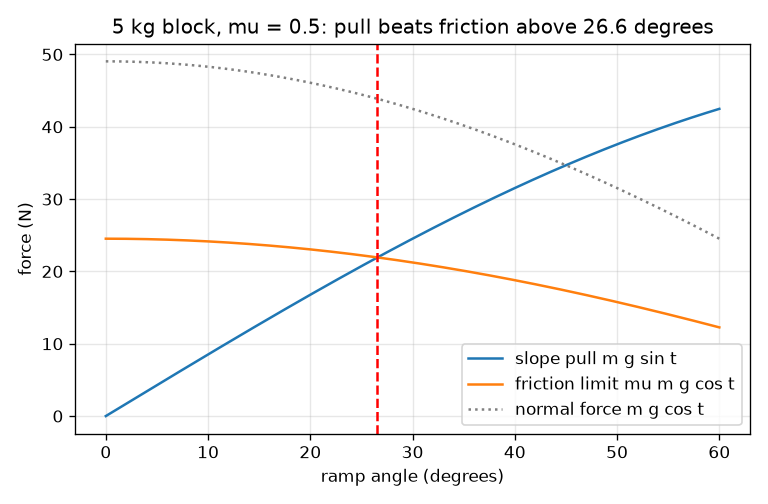
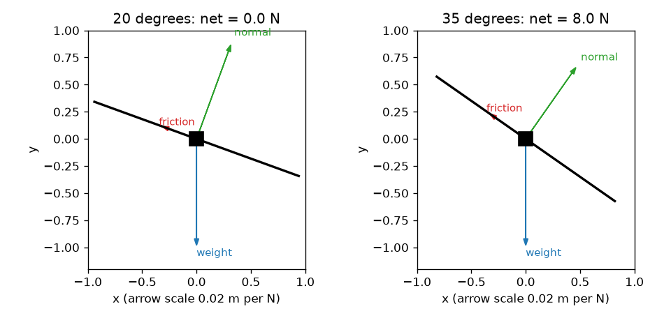

# Session 1: Forces on a ramp: friction is a limit

*Level 1 (conceptual interactive model) · about 60 minutes · openincline*

> This is a simplified educational model. It is not a validated design tool and must not be used for real structures, electrical installations, vehicles, industrial processes or medical decisions.

**Prerequisites**

- School trigonometry: sine, cosine and tangent.
- You know that a force is measured in newtons.
- You have read PRIMER.md and run `python start.py 1` once.

**Learning objectives.** After this session you can:

- Split the weight of a block on a ramp into a part along the slope and a part into the slope.
- Explain why friction has a largest possible value, mu times the normal force.
- Decide by calculation whether a block holds or slides.
- Read a graph of slope pull and friction limit against angle, and find where they cross.

## A. Real-world problem
A parked car on a hill, a box on a loading ramp, a book on a tilted desk. Tilt the surface a little and nothing moves; tilt it more and suddenly it slides. What decides the angle where the sliding starts? Does a heavier block need a steeper ramp? (This is a simplified model for learning, not a design tool for real ramps or vehicles.)

## B. Concept and theory
The weight m g points straight down. On a ramp tilted by an angle t it is easier to use two directions: perpendicular to the ramp, where the ramp pushes back with the normal force N, and along the slope, where the pull F tries to make the block slide. Friction acts up the slope and opposes sliding. It is not a fixed number: it matches the pull exactly, up to a largest value mu times N, where mu (the friction coefficient) has no unit and depends on the two surfaces. If the pull is below the limit nothing moves; if it would exceed the limit the block accelerates. Comparing m g sin t with mu m g cos t, the mass cancels, leaving the slide condition tan t > mu.

| Symbol | Meaning | Unit |
|---|---|---|
| m | mass of the block | kg |
| g | gravity (9.81) | m/s^2 |
| t | ramp angle from the horizontal | degrees |
| N | normal force, perpendicular to the ramp | N |
| F | pull of gravity along the slope | N |
| mu | friction coefficient (one value for Session 1) | no unit |
| f | friction force that actually acts | N |
| a | acceleration down the slope | m/s^2 |

**Assumptions**

- The block is a point mass on a flat, rigid ramp.
- Friction follows the simple law: at most mu N, independent of contact area and speed.
- Session 1 uses one mu for resting and sliding; Session 2 separates them.
- No air resistance, no rotation of the block.

$$ N=mg\cos\theta,\qquad F=mg\sin\theta $$

$$ f_{\max}=\mu N=\mu mg\cos\theta,\qquad f=\min(F,\ \mu N) $$

$$ \text{slides if } mg\sin\theta>\mu mg\cos\theta\iff \tan\theta>\mu,\qquad a=\frac{F-f}{m} $$

## C. Visual explanation
The first figure shows free-body diagrams of a 5 kg block at 20 and 35 degrees with mu = 0.5: weight points straight down, the normal force points out of the ramp, and friction points up the slope. At 20 degrees friction exactly matches the pull and the net force is zero; at 35 degrees friction is at its limit and an 8 N net force remains. The second figure plots the slope pull (rising), the friction limit (falling) and the normal force (falling) against angle. The pull and the limit cross at 26.6 degrees, the slide angle for mu = 0.5.

*Slope pull rises and the friction limit falls; they cross at the slide angle (26.6 degrees for mu = 0.5).*

*Free-body diagrams at 20 degrees (holds) and 35 degrees (slides).*

## D. Interactive simulation
Run the lesson (`python start.py 1`), then open the live app: [Session 1: block on a ramp](https://krunalpanchal1995.github.io/openincline/session-01/) (or `app.html` in this folder). Raise the angle slider and watch the pull and the friction arrows. Change the mass and see that every force scales but the slide angle does not move. Open the graph view and find where the blue and red curves cross.

**Challenge.** Set the friction coefficient to 0.6, then find the smallest whole angle at which the block starts to slide.

## E. Worked example and experiment
**Problem.** A 5 kg block rests on a ramp at 20 degrees with mu = 0.5. Find N, the slope pull and the friction limit. Does it hold? At what angle would it begin to slide?

1. N = m g cos t = 5 * 9.81 * cos 20 = 5 * 9.81 * 0.9397 = 46.09 N.
2. Pull F = m g sin t = 5 * 9.81 * 0.3420 = 16.78 N.
3. Friction limit = mu N = 0.5 * 46.09 = 23.05 N.
4. The pull 16.78 N is below the limit 23.05 N, so the block holds: friction equals 16.78 N and the net force is 0.
5. The slide angle solves tan t = mu = 0.5, so t = arctan 0.5 = 26.57 degrees. Check: tan 20 = 0.364 < 0.5, consistent with holding.

**Answer.** N = 46.09 N, pull = 16.78 N, limit = 23.05 N; the block holds with 16.78 N of friction. It starts to slide above 26.57 degrees, whatever its mass.

**Experiment.** Put any block on a board and tilt it slowly with a phone angle app on the board. Note the angle where it slips; tan of that angle estimates mu. Repeat with a lighter object of the same material: the angle should be about the same. Real surfaces vary from trial to trial by a degree or two (dust, how long the block sat, small bumps), while the model has one exact mu; that scatter is the main difference between model and reality.

## F. Assessment and design challenge
**Question type A: Conceptual.** What determines whether a block at rest on a ramp begins to slide? Does the mass matter? Does the size of the block's bottom face matter?

Hint

Compare m g sin t with mu m g cos t. What cancels?

Step-by-step solution

Only the angle and the friction coefficient of the two surfaces decide: the block slides when tan t is larger than mu. The mass m appears in both the pull and the friction limit and cancels, so a heavy and a light block of the same material start to slide at the same angle. In the simple friction law the contact area does not matter either: a bigger face spreads the same N over more area but the limit mu N is unchanged.

**Question type B: Numerical.** An 8 kg block sits on a ramp at 15 degrees, mu = 0.35. Find N, the pull, the friction limit and the friction that acts. Does it slide? Sanity check the answer.

Hint

Use N = m g cos t, F = m g sin t, limit = mu N, then compare.

Step-by-step solution

N = 8 * 9.81 * cos 15 = 75.81 N. F = 8 * 9.81 * sin 15 = 20.31 N. Limit = 0.35 * 75.81 = 26.53 N. Since 20.31 < 26.53 the block holds and the friction that acts is 20.31 N. Check: the slide angle is arctan 0.35 = 19.29 degrees, above 15 degrees, so holding is right. Units: newtons.

**Question type C: Graph and simulation interpretation.** On the force graph for a 5 kg block, the slope pull and the friction limit cross at 26.6 degrees for mu = 0.5. Where would they cross for mu = 0.8, and which curve moves? What does the friction curve do to the left of the crossing?

Hint

Only the friction-limit curve contains mu. Solve tan t = 0.8.

Step-by-step solution

The red friction-limit curve scales up with mu, so it moves up and the crossing moves right to arctan 0.8 = 38.66 degrees. The pull curve does not contain mu and stays put. To the left of the crossing the limit is above the pull, so the block holds there; to the right the pull is larger and the block slides.

**Question type D: Design and optimisation challenge.** Design: a 20 kg box must stay put without a rope on a wooden ramp with mu = 0.45. Pick a maximum ramp angle with a safety margin, so that the friction needed is at most 80 percent of the limit. A 1.2 m rise is needed. How long must the ramp be? What is the trade-off?

Hint

The friction needed is the pull, so F <= 0.8 * mu N means tan t <= 0.8 mu. Length = rise / sin t.

Step-by-step solution

tan t <= 0.8 * 0.45 = 0.36, so t <= 19.80 degrees (the slide angle is 24.23 degrees). Ramp length = 1.2 / sin 19.80 = 3.54 m. At the slide angle it would be only 2.92 m but with no safety margin. The trade-off is space against safety: a gentler, longer ramp is safer if the surface gets wet or dusty and mu drops. The mass of 20 kg does not change the answer. This is a classroom model; real ramps need professional design.

Score yourself with [RUBRIC.md](../../RUBRIC.md). Print the [activity sheet](activity_sheet.md) to work on paper.

## Common misconceptions
| Common misconception | What is actually true |
|---|---|
| A heavier block needs a steeper ramp before it slides. | Mass cancels: the slide condition tan t > mu does not contain m. |
| Friction always equals mu times N. | Friction equals the pull while the block holds; mu N is only the largest it can be. |
| The normal force always equals the weight. | On a ramp N = m g cos t, which is smaller than the weight and shrinks as the ramp gets steeper. |
| A block at rest has zero force on it. | Several forces act; they balance. The net force is zero, not each force. |

## Glossary
- **normal force**: the push of a surface on an object, perpendicular to the surface
- **friction coefficient (mu)**: a number with no unit that sets the largest friction as a fraction of the normal force
- **free-body diagram**: a drawing of one object with an arrow for every force on it
- **net force**: the sum of all forces on an object; zero means no acceleration
- **slide angle**: the ramp angle at which a block at rest first starts to slide

## Finish
1. Do the three coding tasks in [exercises.md](exercises.md).
2. Run `python start.py 1` again after your changes. It ends with the checkpoint; when it prints `PASS`, you are done. (Checkpoint only: `python start.py check 1`.)

Next: [Session 2](../session-02/README.md)
