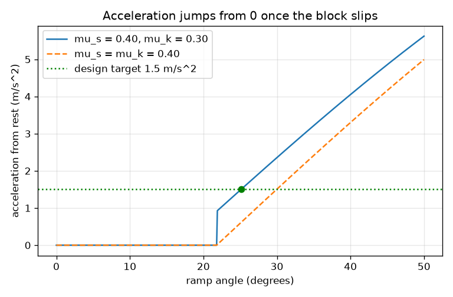
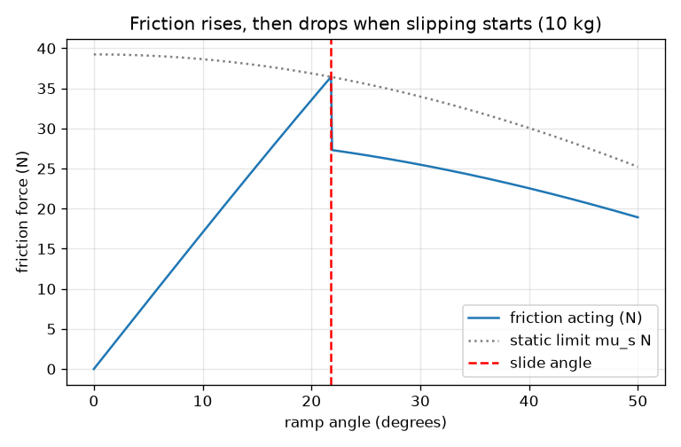

# Session 2: The equations: static and kinetic friction

*Level 2 (mathematical engineering model) · about 75 minutes · openincline*

> This is a simplified educational model. It is not a validated design tool and must not be used for real structures, electrical installations, vehicles, industrial processes or medical decisions.

**Prerequisites**

- Session 1: normal force, slope pull and the friction limit.
- Rearranging a simple equation; the sine and cosine of an angle.

**Learning objectives.** After this session you can:

- Use N = m g cos t, F = m g sin t and tan t = mu_s to decide whether a block starts to move.
- Explain why kinetic friction is usually smaller than the maximum static friction, and what that does to the motion.
- Compute the acceleration a = g (sin t - mu_k cos t), then speed and distance from rest.
- Solve an inverse problem: choose the ramp angle that gives a required acceleration, and check the crate starts.

## A. Real-world problem
A warehouse wants crates to slide down a ramp by themselves and reach the bottom at a gentle, known speed. If the ramp is too shallow the crate never starts; too steep and it arrives too fast. The surface decides the friction. Which angle should the ramp have to make a crate slide 3 m in 2 seconds? (Simplified model; real crate handling needs a professional safety assessment.)

## B. Concept and theory
A block at rest is held by static friction, which can be as large as mu_s N. Once the block slides, kinetic friction acts with a constant size mu_k N, usually a little smaller (mu_k <= mu_s). While the block holds, friction equals the pull and the net force is zero. The block starts as soon as tan t > mu_s. After that Newton's second law along the slope, m a = m g sin t - mu_k m g cos t, gives an acceleration that does not depend on the mass. From rest with constant a, speed is v = a t and distance x = (1/2) a t^2. Because friction drops from its limit mu_s N to mu_k N when slipping starts, the acceleration jumps from 0 to a positive value instead of growing smoothly.

| Symbol | Meaning | Unit |
|---|---|---|
| mu_s | static friction coefficient | no unit |
| mu_k | kinetic friction coefficient (mu_k <= mu_s) | no unit |
| t | ramp angle | degrees |
| a | acceleration down the slope | m/s^2 |
| v | speed after time T | m/s |
| x | distance travelled from rest | m |
| T | time since release | s |

**Assumptions**

- Friction coefficients are constants of the two surfaces.
- The block starts from rest at the top and stays on the ramp.
- No air resistance, no rotation of the block.
- mu_k is not larger than mu_s (the app uses the smaller of the two).

$$ \text{holds if } \tan\theta\le\mu_s,\qquad \theta_{\text{slide}}=\arctan\mu_s $$

$$ a=g\,(\sin\theta-\mu_k\cos\theta) $$

$$ v=aT,\qquad x=\tfrac12 aT^2 $$

$$ \theta=\arctan\mu_k+\arcsin\!\left(\frac{a}{g\sqrt{1+\mu_k^2}}\right) $$

## C. Visual explanation
The first figure plots the friction acting on a 10 kg crate against the angle. It climbs along the pull up to the static limit mu_s N, then drops to mu_k N at the slide angle of 21.8 degrees. The second plots the acceleration against angle for mu_s = 0.40 and mu_k = 0.30: it is zero until 21.8 degrees, jumps to about 0.95 m/s^2 and then rises steadily; the green marker is the design target of 1.5 m/s^2 at 25.1 degrees. A dashed curve with mu_k = mu_s = 0.40 starts from zero smoothly, showing the effect of the drop.

*Acceleration from rest: zero until 21.8 degrees, then a jump; the green dot is the design point.*

*Friction acting on a 10 kg crate: it rises with the pull, then drops at the slide angle.*

## D. Interactive simulation
Run the lesson (`python start.py 2`), then open the live app: [Session 2: static and kinetic friction](https://krunalpanchal1995.github.io/openincline/session-02/) (or `app.html` in this folder). Move the angle and watch the arrow change from static to kinetic friction at the slide angle. In the friction view find the drop, and in the acceleration view see the jump. Change mu_k and see which graph moves.

**Challenge.** For a crate with mu_s = 0.40 and mu_k = 0.30, set an angle so that the crate slides about 3 m in 2 s (a = 1.5 m/s^2, within 0.1).

## E. Worked example and experiment
**Problem.** A 10 kg crate is released from rest on a ramp at 30 degrees with mu_s = 0.40 and mu_k = 0.30. Does it slide? Find the friction, the acceleration, and the speed and distance after 2 s.

1. tan 30 = 0.577 > mu_s = 0.40, so the crate slides (the slide angle is arctan 0.40 = 21.80 degrees).
2. N = 10 * 9.81 * cos 30 = 84.96 N; kinetic friction = 0.30 * 84.96 = 25.49 N (the static limit would have been 33.98 N).
3. Pull = 10 * 9.81 * sin 30 = 49.05 N, so net force = 49.05 - 25.49 = 23.56 N and a = 23.56 / 10 = 2.356 m/s^2.
4. Check with the formula: a = 9.81 * (0.5 - 0.30 * 0.8660) = 2.356 m/s^2; the mass cancelled.
5. After 2 s: v = 2.356 * 2 = 4.71 m/s and x = 0.5 * 2.356 * 4 = 4.71 m.

**Answer.** The crate slides with a = 2.356 m/s^2; after 2 s it moves at 4.71 m/s and has travelled 4.71 m.

**Experiment.** Use a board, a phone angle app and a block with a stopwatch app or a phone video: set about 30 degrees, release the block from rest, and time its slide over 1 m. Compute a = 2 x / T^2 and compare with the formula using mu_k found from your own slip tests. Real blocks differ because mu_k varies along the board, the block can tilt, and your timing has a reaction-time error of about 0.1 s; the model has a perfectly uniform surface.

## F. Assessment and design challenge
**Question type A: Conceptual.** Why does a block often 'jerk' into motion rather than speeding up smoothly from rest? What happens to the friction force at the moment of slipping?

Hint

Compare the static limit mu_s N with kinetic friction mu_k N.

Step-by-step solution

Static friction can grow up to mu_s N, but once the block slips only kinetic friction mu_k N acts, and mu_k is usually smaller. The friction force therefore drops suddenly at the slip angle, so the net force down the slope jumps from zero to a positive value and the acceleration jumps with it. The bigger the gap between mu_s and mu_k, the stronger the jerk (this is also behind stick-slip squeaks).

**Question type B: Numerical.** A 4 kg block is released at 35 degrees with mu_s = 0.5 and mu_k = 0.4. Does it slide? Find the friction force and the acceleration. Show a sanity check.

Hint

Compare tan 35 with mu_s first, then use a = g (sin t - mu_k cos t).

Step-by-step solution

tan 35 = 0.700 > 0.5, so it slides. Kinetic friction = 0.4 * 4 * 9.81 * cos 35 = 12.86 N; the pull is 4 * 9.81 * sin 35 = 22.51 N. a = 9.81 * (0.5736 - 0.4 * 0.8192) = 2.412 m/s^2. Check: net force 22.51 - 12.86 = 9.65 N divided by 4 kg = 2.41 m/s^2. Units: m/s^2.

**Question type C: Graph and simulation interpretation.** On the acceleration graph for mu_s = 0.40 and mu_k = 0.30, what is the acceleration just above the slide angle? Why is the graph not a smooth curve starting at 0?

Hint

Evaluate g (sin t - mu_k cos t) at 22 degrees.

Step-by-step solution

At 22 degrees a = 9.81 * (0.3746 - 0.30 * 0.9272) = 0.946 m/s^2, so the graph jumps from 0 to about 0.95 m/s^2 at 21.8 degrees. It is not smooth because the friction force drops from mu_s N to mu_k N when slipping starts; if mu_k equalled mu_s the curve would start smoothly from zero.

**Question type D: Design and optimisation challenge.** Design: choose the ramp angle (whole degrees) so that a crate with mu_s = 0.40 and mu_k = 0.30 slides 3 m in 2 s. Check it starts. How high is the top of a 3 m long ramp? What goes wrong if the surface had mu_k = 0.20 but mu_s = 0.40?

Hint

Needed a = 2 * 3 / 2^2 = 1.5 m/s^2. Solve numerically or use theta = arctan(mu_k) + arcsin(a / (g sqrt(1 + mu_k^2))).

Step-by-step solution

a = 1.5 m/s^2 gives t = 25.12 degrees; whole degrees: 25 degrees gives a = 1.479 m/s^2, 2.96 m in 2 s and a final speed of 2.96 m/s. It starts because tan 25 = 0.466 > 0.40. Height of a 3 m ramp = 3 * sin 25 = 1.27 m. With mu_k = 0.20 the formula gives 19.9 degrees, but that is below the slide angle 21.8 degrees, so the crate would never start: the design needs both the angle for the acceleration and the check tan t > mu_s. Trade-off: the margin above the slide angle is only about 3 degrees, so a rougher surface could stop the crate; a slightly steeper ramp is more robust but faster.

Score yourself with [RUBRIC.md](../../RUBRIC.md). Print the [activity sheet](activity_sheet.md) to work on paper.

## Common misconceptions
| Common misconception | What is actually true |
|---|---|
| Friction on a sliding block is the same as the friction just before it moves. | Static friction can reach mu_s N; once sliding, kinetic friction mu_k N usually acts and is smaller. |
| A heavier crate accelerates faster down the ramp. | Mass cancels in a = g (sin t - mu_k cos t); a heavier crate has more pull and more friction in the same ratio. |
| The slide angle depends on how fast the block will go. | The slide angle atan(mu_s) depends only on mu_s; the speed afterwards depends on mu_k and the angle. |
| If the formula gives an angle, the design works. | You must also check that the block starts at all (tan t > mu_s). |

## Glossary
- **static friction**: friction on a block at rest; it adjusts up to a maximum mu_s N
- **kinetic friction**: friction on a sliding block; a constant mu_k N
- **bisection**: a numeric method that halves a search interval again and again until it finds the answer
- **inverse problem**: finding the input that produces a wanted output, such as the angle for a wanted acceleration
- **stick-slip**: jerky motion caused by friction alternating between static and kinetic values

## Finish
1. Do the three coding tasks in [exercises.md](exercises.md).
2. Run `python start.py 2` again after your changes. It ends with the checkpoint; when it prints `PASS`, you are done. (Checkpoint only: `python start.py check 2`.)

Next: [Session 3](../session-03/README.md)
