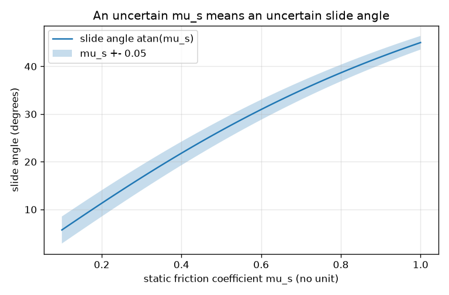
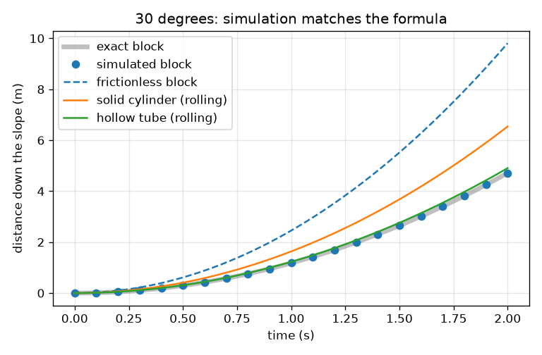
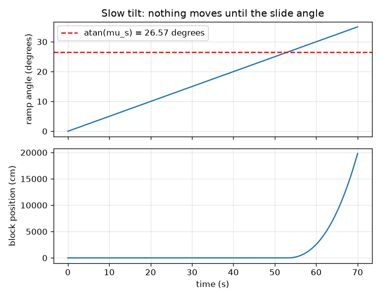

# Session 3: Simulating the block and validating it

*Level 3 (simulation and validation) · about 90 minutes · openincline*

> This is a simplified educational model. It is not a validated design tool and must not be used for real structures, electrical installations, vehicles, industrial processes or medical decisions.

**Prerequisites**

- Session 1: forces on a ramp.
- Session 2: static and kinetic friction and a = g (sin t - mu_k cos t).
- A for-loop in Python.

**Learning objectives.** After this session you can:

- Build a time-stepping simulation with a stuck state and a sliding state.
- Validate it against two exact results: x = (1/2) a t^2 and the slide angle atan(mu_s).
- Estimate how an uncertainty in mu_s changes the slide angle.
- Compare a sliding block with a rolling cylinder using a = g sin t / (1 + I / (m r^2)).

## A. Real-world problem
To measure a friction coefficient you tilt a board slowly until the block slips, but you cannot see the exact instant and the coefficient is never known exactly. Before trusting a model, an engineer checks that the simulation reproduces cases with a known exact answer, and asks how much an uncertain input changes the result. Can we simulate the tilting test, check it, and decide how precisely mu_s must be known? (Educational model only, not a validated tool for real ramps or vehicles.)

## B. Concept and theory
Cut time into small steps dt. In the stuck state the block does not move until the pull m g sin t exceeds the static limit mu_s m g cos t; then it switches to sliding. In the sliding state a = g (sin t - mu_k cos t); position and speed are advanced by x + v dt + (1/2) a dt^2 and v + a dt, and if the speed would turn negative the block stops and is stuck again. The ramp angle can change in time, so the simulation can tilt the ramp slowly as in the real test. Validation compares the output with exact references. Because tan t = mu_s, a small error d(mu) in mu_s changes the slide angle by d(mu) / (1 + mu^2) radians. A body that rolls without slipping also spins, so its acceleration is g sin t / (1 + k) with k = I / (m r^2): k = 1/2 for a solid cylinder and 1 for a hollow tube. Friction does no work on a rolling body; it only needs to be large enough: mu_s >= tan t * k / (1 + k).

| Symbol | Meaning | Unit |
|---|---|---|
| dt | time step | s |
| theta(t) | ramp angle as a function of time | degrees |
| x, v | position and speed down the slope | m, m/s |
| d(mu) | uncertainty of mu_s | no unit |
| I | moment of inertia of the rolling body about its axis | kg m^2 |
| k | I / (m r^2), the shape factor of the rolling body | no unit |
| r | radius of the rolling body | m |

**Assumptions**

- Constant mu_s and mu_k; the block is a point mass.
- A rolling body never slips and has no rolling resistance (check mu_s >= tan t * k / (1 + k)).
- Constant tilt rate in the tilting test; no vibration or sticking history.
- Error estimates use small changes in mu_s (linear sensitivity).

$$ x_{n+1}=x_n+v_n\,\Delta t+\tfrac12 a\,\Delta t^2,\qquad v_{n+1}=v_n+a\,\Delta t $$

$$ \theta_{\text{slip}}=\arctan\mu_s,\qquad \Delta\theta\approx\frac{\Delta\mu}{1+\mu_s^2}\ \text{(radians)} $$

$$ a_{\text{roll}}=\frac{g\sin\theta}{1+I/(mr^2)},\qquad \mu_s\ge\tan\theta\,\frac{k}{1+k} $$

## C. Visual explanation
The first figure plots the simulated distance (dots) against the exact (1/2) a t^2 curve (grey) at 30 degrees: they coincide. A frictionless block would be fastest, the solid cylinder next, then the hollow tube, and the rough block with mu_k = 0.30 is the slowest at about the same speed as the hollow tube. The second figure shows a slow tilt: the ramp angle grows at 0.5 degrees per second and the block does not move at all until the angle reaches 26.57 degrees (after 53.1 s), the exact slide angle for mu_s = 0.5. The third figure plots atan(mu_s) with a band for an uncertainty of 0.05, which is widest for small mu_s and narrower for large mu_s, because the curve flattens.

*Slide angle against mu_s with a +-0.05 uncertainty band.*

*Simulated distance (dots) against the exact curve at 30 degrees; frictionless block and rolling bodies for comparison.*

*A slow tilt: the block does not move until the angle reaches the slide angle (26.57 degrees).*

## D. Interactive simulation
Run the lesson (`python start.py 3`), then open the live app: [Session 3: simulate and validate](https://krunalpanchal1995.github.io/openincline/session-03/) (or `app.html` in this folder). Move the time slider and compare the simulated distance with the exact value in the readout. In the distance view compare the block with the two rolling bodies. In the sensitivity view see how a +-0.05 uncertainty of mu_s changes the slide angle.

**Challenge.** With mu_s = 0.40 and mu_k = 0.30, choose an angle and a time so that the block has travelled about 3 m (between 2.9 and 3.1 m).

## E. Worked example and experiment
**Problem.** Simulate a block at a fixed 30 degrees with mu_s = 0.40 and mu_k = 0.30 for 2 s. Compare with the exact distance, then find how a 0.05 uncertainty in mu_s = 0.5 moves the slide angle.

1. tan 30 = 0.577 > 0.40, so the simulation switches to sliding immediately.
2. Exact a = 9.81 * (sin 30 - 0.30 * cos 30) = 2.356 m/s^2, so exact x(2 s) = 0.5 * 2.356 * 4 = 4.71 m and v = 4.71 m/s.
3. The simulation with dt = 0.001 s gives the same x(t) to within 1e-6 m over the whole 2 s, because the update rule is exact for constant acceleration.
4. Tilting test with mu_s = 0.5: the simulation slips at 26.566 degrees against the exact arctan 0.5 = 26.565 degrees.
5. Sensitivity: mu_s = 0.45 gives arctan 0.45 = 24.23 degrees and mu_s = 0.55 gives 28.81 degrees, a spread of 4.58 degrees, or about +-2.3 degrees; the linear formula 0.05 / 1.25 rad = 2.29 degrees agrees.

**Answer.** Simulated and exact motion agree (4.71 m after 2 s, error below 1e-6 m); the simulated slide angle is 26.57 degrees, as arctan 0.5; a 0.05 uncertainty in mu_s = 0.5 gives about +-2.3 degrees in the slide angle.

**Experiment.** Tilt a board slowly with a phone angle app and record the slip angle of a block 10 times. The scatter (often 1 to 2 degrees) is your measurement of the uncertainty that the model treats as zero. Convert the mean angle and the scatter to mu_s with tan, as in the mini-project. The simulation is exact for an ideal surface; the real board has dust, a history of sticking, and a reading error of the phone.

## Real-world application and mini-project: Measure the friction coefficient with a board and a phone
Put a block (a book, a wooden block, an eraser) on a flat board. Lift one end slowly while a phone angle app lies on the board and shows the tilt; note the angle at which the block first starts to slip. Repeat at least 10 times, wiping the surfaces each time, and then try a second surface (sandpaper or cloth). You do not need a ramp to begin: `synthetic_tilt_trials()` in Session 3 makes made-up data, and the lesson saves it as `ramp_trials.csv` (columns trial and slip_angle_deg) so you can test your analysis first. Safety: keep fingers clear and use a soft landing area. Use only objects that are safe to drop.

**Deliverable:** A script that reads your CSV, prints the mean slip angle, mu_s = tan(mean angle) and a range of mu_s (mean angle plus or minus 2 standard errors) using `estimate_mu`, and a short note comparing two surfaces.

**Success looks like:** On the synthetic file, mu_s is within 0.02 of the true 0.42 and the range contains 0.42; on your own data, repeated sets of trials agree within the stated range.

## F. Assessment and design challenge
**Question type A: Conceptual.** Why does the simulation need a 'stuck' state? What would go wrong if it always used kinetic friction?

Hint

What does a = g (sin t - mu_k cos t) give for a block that is held by static friction?

Step-by-step solution

Below the slide angle the block holds, with friction equal to the pull. Using the sliding formula with mu_k would give a positive acceleration whenever tan t > mu_k, so the simulated block would creep or slide at angles where a real block stays put, and the slip angle would come out as arctan(mu_k) instead of arctan(mu_s). The stuck state with the static limit is what reproduces the right slide angle.

**Question type B: Numerical.** A block has mu_s = 0.30 with an uncertainty of +-0.03. Find the range of its slide angle. Compare with the linear estimate.

Hint

Use arctan(0.27) and arctan(0.33). The linear estimate is d(mu) / (1 + mu^2) in radians.

Step-by-step solution

arctan 0.27 = 15.11 degrees and arctan 0.33 = 18.26 degrees, so the slide angle is 16.70 degrees with a range of about +-1.6 degrees. Linear estimate: 0.03 / (1 + 0.09) = 0.0275 rad = 1.58 degrees. They agree; the symmetric range is a good approximation for small d(mu).

**Question type C: Graph and simulation interpretation.** In the slow-tilt figure the block does not move until about 53 s. Why 53 s? What would you see if the tilt rate were doubled to 1 degree per second?

Hint

Time = angle / rate. Which angle?

Step-by-step solution

The slip angle for mu_s = 0.5 is 26.57 degrees, and at 0.5 degrees per second the ramp reaches it after 26.57 / 0.5 = 53.1 s. At twice the rate the block slips at the same angle, after 26.6 s: the slip angle does not depend on the rate in the model (the simulation at 5 degrees per second still gives 26.57 degrees, with a small delay of one time step).

**Question type D: Design and optimisation challenge.** Design: a 2 m ramp at 20 degrees must deliver a rolling barrel to the bottom in at least 1.5 s so that the barrel does not hit the stop too hard. Compare a solid cylinder (k = 0.5) and a hollow tube (k = 1.0). Which satisfies the limit, and what friction coefficient is needed to avoid slipping?

Hint

a = g sin t / (1 + k), time = sqrt(2 d / a), and mu_s >= tan t * k / (1 + k).

Step-by-step solution

At 20 degrees: solid cylinder a = 2.237 m/s^2, time = 1.337 s (too fast); hollow tube a = 1.678 m/s^2, time = 1.544 s (meets the limit). A frictionless block would take only 1.092 s. The hollow tube needs mu_s >= tan 20 * 0.5 = 0.182 to roll without slipping, so choose a surface with mu_s of 0.25 or more for a margin. Trade-off: a more massive rim slows the descent but needs more friction to avoid slipping at steeper angles.

Score yourself with [RUBRIC.md](../../RUBRIC.md). Print the [activity sheet](activity_sheet.md) to work on paper.

## Common misconceptions
| Common misconception | What is actually true |
|---|---|
| A simulation that looks right is correct. | A simulation is trusted only after it reproduces cases with a known exact answer and its result stops changing when dt is reduced. |
| Friction slows a rolling cylinder. | Friction on a body that rolls without slipping does no work; the cylinder is slower than a frictionless block because part of the energy goes into spinning. |
| The slide angle is exactly known once mu_s is measured. | mu_s has an uncertainty, and the slide angle inherits it: about d(mu) / (1 + mu^2) in radians. |
| A rolling cylinder always rolls. | If mu_s is smaller than tan t * k / (1 + k) the cylinder slips and the rolling formula no longer applies. |

## Glossary
- **time step (dt)**: the small slice of time the simulation advances in one go
- **validation**: checking a model against an exact or measured reference
- **sensitivity**: how much the output changes when an input changes slightly
- **moment of inertia**: how hard it is to change the spinning of a body
- **synthetic data**: made-up data generated by code, used to test an analysis before real data exist

## Finish
1. Do the three coding tasks in [exercises.md](exercises.md).
2. Run `python start.py 3` again after your changes. It ends with the checkpoint; when it prints `PASS`, you are done. (Checkpoint only: `python start.py check 3`.)

Next: the [roadmap](../../promo/roadmap.md). Session 4 is yours to build.
